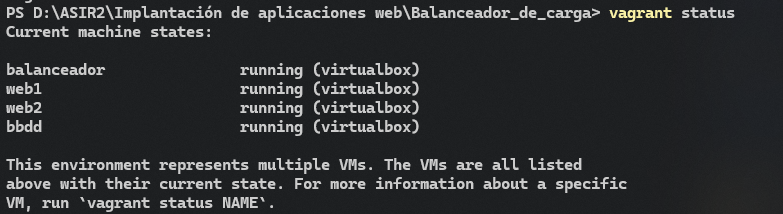
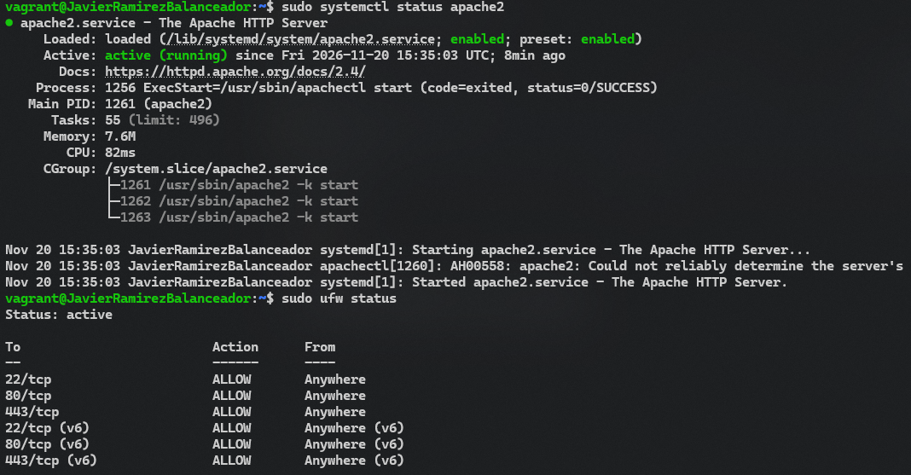
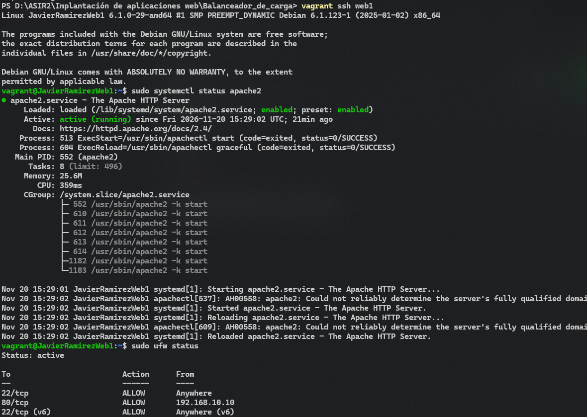
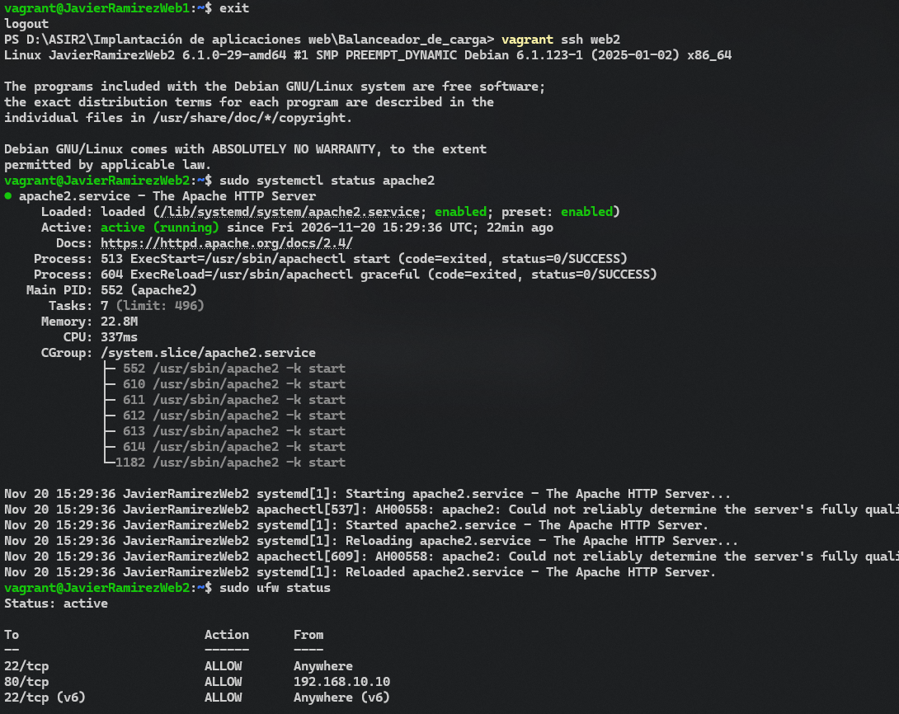
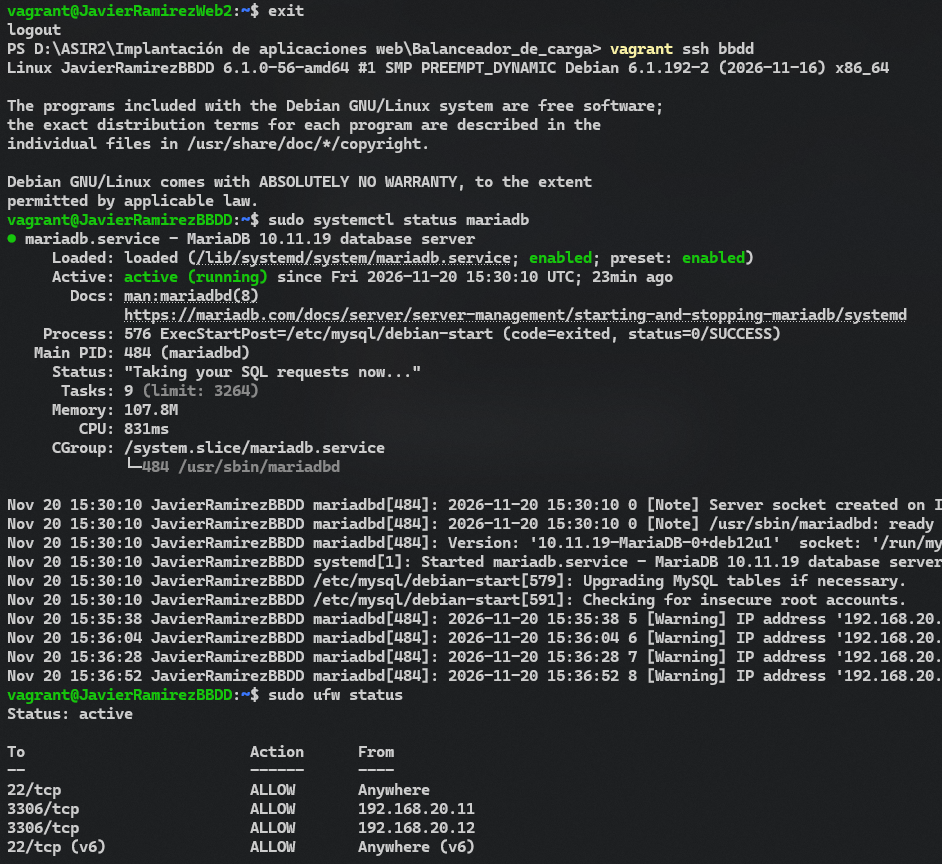
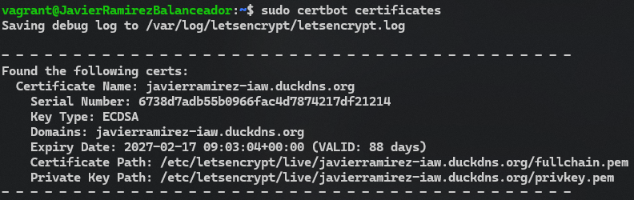

# Balanceador de Carga con Apache en Arquitectura de 3 Niveles

Práctica de **Implantación de Aplicaciones Web** consistente en el despliegue automatizado de una aplicación web sobre una arquitectura de tres niveles con balanceo de carga en Apache, seguridad perimetral mediante firewall (UFW) y cifrado HTTPS con certificado válido de Let's Encrypt.


## Índice

1. [Introducción](#1-introducción)
2. [Arquitectura e infraestructura](#2-arquitectura-e-infraestructura)
3. [Aprovisionamiento de la infraestructura con Vagrant](#3-aprovisionamiento-de-la-infraestructura-con-vagrant)
4. [Configuración de la Capa 1: Balanceador de carga con Apache](#4-configuración-de-la-capa-1-balanceador-de-carga-con-apache)
5. [Configuración de la Capa 2: Servidores Web (Backend)](#5-configuración-de-la-capa-2-servidores-web-backend)
6. [Configuración de la Capa 3: Servidor de Base de Datos](#6-configuración-de-la-capa-3-servidor-de-base-de-datos)
7. [Seguridad: Reglas de firewall (UFW)](#7-seguridad-reglas-de-firewall-ufw)
8. [Instalación del certificado SSL/TLS con Certbot y Let's Encrypt](#8-instalación-del-certificado-ssltls-con-certbot-y-lets-encrypt)
9. [Pruebas de funcionamiento](#9-pruebas-de-funcionamiento)
10. [Screencast de demostración](#10-screencast-de-demostración)

## 1. Introducción

El objetivo de esta práctica es desplegar una aplicación web escalable y segura separando sus responsabilidades en **tres niveles independientes** (balanceador, servidores de aplicación y base de datos). Esta separación mejora tanto el rendimiento al repartir las peticiones entre varios nodos web como la seguridad, ya que únicamente el balanceador queda expuesto al exterior mientras los servidores web y la base de datos permanecen aislados en redes privadas.

Para el despliegue se ha utilizado **Vagrant** junto con **VirtualBox**, automatizando la creación y configuración inicial de las cuatro máquinas virtuales mediante scripts de aprovisionamiento en Bash.


## 2. Arquitectura e infraestructura

La infraestructura se compone de cuatro máquinas virtuales organizadas en tres capas:

| Capa | Nombre de la máquina | Rol | Red / Acceso | Servicios principales |
| :--- | :--- | :--- | :--- | :--- |
| **Capa 1** | `JavierRamirezBalanceador` | Balanceador de carga | Red pública (puertos `8080→80` y `8443→443`) y red privada | Apache, Certbot, UFW |
| **Capa 2** | `JavierRamirezWeb1` | Servidor Web 1 (Backend) | Red privada (`192.168.10.11`) | Apache, PHP, aplicación web, UFW |
| **Capa 2** | `JavierRamirezWeb2` | Servidor Web 2 (Backend) | Red privada (`192.168.10.12`) | Apache, PHP, aplicación web, UFW |
| **Capa 3** | `JavierRamirezBBDD` | Servidor de Base de Datos | Red privada | MariaDB, UFW |

## 3. Aprovisionamiento de la infraestructura con Vagrant

El entorno se ha definido en el archivo `Vagrantfile`, que levanta las cuatro máquinas virtuales, asigna los nombres de host correspondientes, configura los adaptadores de red y ejecuta los scripts de aprovisionamiento (`instalar_balanceador.sh`, scripts de servidores web y script de base de datos).

Para iniciar todo el escenario se ejecuta:

```bash
vagrant up
```


Comprobación del estado de las cuatro máquinas virtuales ejecutando `vagrant status`:



## 4. Configuración de la Capa 1: Balanceador de carga con Apache

En la máquina `JavierRamirezBalanceador` se ha instalado Apache junto con los módulos necesarios para actuar como proxy inverso y balanceador de carga mediante el algoritmo de reparto por peticiones:

```bash
sudo a2enmod proxy proxy_http proxy_balancer lbmethod_byrequests ssl
```

A continuación, en el archivo `/etc/apache2/sites-available/000-default.conf` se define el clúster `balancer://servidores_web` apuntando a los dos nodos de la Capa 2 (`192.168.10.11` y `192.168.10.12`), configurando los `VirtualHost` para los puertos 80 (HTTP) y 443 (HTTPS):

```apache
<Proxy "balancer://servidores_web">
    BalancerMember [http://192.168.10.11](http://192.168.10.11)
    BalancerMember [http://192.168.10.12](http://192.168.10.12)
    ProxySet lbmethod=byrequests
</Proxy>

<VirtualHost *:80>
    ServerName javierramirez-iaw.duckdns.org
    ProxyPreserveHost On
    ProxyPass / balancer://servidores_web/
    ProxyPassReverse / balancer://servidores_web/
</VirtualHost>

<VirtualHost *:443>
    ServerName javierramirez-iaw.duckdns.org

    SSLEngine on
    SSLCertificateFile /etc/letsencrypt/live/javierramirez-iaw.duckdns.org/fullchain.pem
    SSLCertificateKeyFile /etc/letsencrypt/live/javierramirez-iaw.duckdns.org/privkey.pem

    ProxyPreserveHost On
    ProxyPass / balancer://servidores_web/
    ProxyPassReverse / balancer://servidores_web/
</VirtualHost>
```
Comprobación del estado de Apache y las reglas del firewall en `JavierRamirezBalanceador`:



## 5. Configuración de la Capa 2: Servidores Web (Backend)

Las máquinas `JavierRamirezWeb1` y `JavierRamirezWeb2` alojan la aplicación web en PHP conectada al servidor de base de datos de la Capa 3. Para identificar qué servidor atiende cada petición, cada nodo muestra una cabecera con su nombre.

### Comprobación en `JavierRamirezWeb1`



### Comprobación en `JavierRamirezWeb2`



## 6. Configuración de la Capa 3: Servidor de Base de Datos

La máquina `JavierRamirezBBDD` aloja el gestor de base de datos **MariaDB**, configurado para aceptar conexiones únicamente desde la red privada de los servidores web de la Capa 2 y garantizar la persistencia de datos independientemente del servidor web que atienda la solicitud.

Comprobación del servicio de base de datos y firewall en `JavierRamirezBBDD`:



## 7. Seguridad: Reglas de firewall (UFW)

Para permitir únicamente el tráfico necesario en cada nivel (equivalente a las listas de control de acceso y grupos de seguridad), se ha configurado **UFW** con política por defecto de denegación de tráfico entrante (`default deny incoming`):

* **Capa 1 (`JavierRamirezBalanceador`):** Permite únicamente SSH (`22/tcp`), HTTP (`80/tcp`) y HTTPS (`443/tcp`).
* **Capa 2 (`JavierRamirezWeb1` y `JavierRamirezWeb2`):** Permite SSH para administración y tráfico HTTP procedente del balanceador.
* **Capa 3 (`JavierRamirezBBDD`):** Permite SSH para administración y tráfico MariaDB (`3306/tcp`) procedente únicamente de los servidores web.


## 8. Instalación del certificado SSL/TLS con Certbot y Let's Encrypt

Para obtener un certificado SSL/TLS válido en un entorno virtualizado local, se ha registrado el subdominio gratuito **`javierramirez-iaw.duckdns.org`** en DuckDNS apuntando a `127.0.0.1` y se ha validado mediante desafío **DNS-01** con **Certbot**:

```bash
sudo certbot certonly --manual --preferred-challenges dns -d javierramirez-iaw.duckdns.org
```

Tras publicar el registro `TXT` en `_acme-challenge.javierramirez-iaw.duckdns.org`, Let's Encrypt emitió el certificado (`fullchain.pem`) y la clave privada (`privkey.pem`) en `/etc/letsencrypt/live/javierramirez-iaw.duckdns.org/`, que se vincularon al `VirtualHost` del puerto `443` en Apache.

Verificación del certificado emitido con `sudo certbot certificates`:



## 9. Pruebas de funcionamiento

Al acceder a `https://javierramirez-iaw.duckdns.org:8443` desde el navegador se comprueba:

1. **Conexión segura (HTTPS):** El navegador muestra el candado de seguridad con un certificado válido emitido por Let's Encrypt para el dominio.
2. **Balanceo de carga:** Al recargar la página (`F5`), las peticiones alternan entre `JavierRamirezWeb1` y `JavierRamirezWeb2`.
3. **Persistencia en la base de datos:** Al añadir un nuevo registro desde *Add New Data*, los datos se guardan en `JavierRamirezBBDD` y son visibles desde ambos servidores web.

## 10. Screencast de demostración

En el siguiente vídeo se muestra el funcionamiento de la aplicación desplegada, la validez del certificado SSL, el balanceo de carga entre los dos servidores web y el guardado de datos en la base de datos:

* **Enlace al screencast:** [Ver demostración del proyecto](AQUI_TU_ENLACE_AL_VIDEO)
